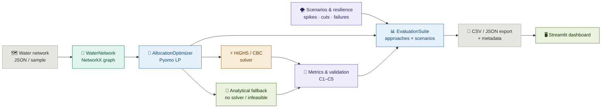

<div align="center">

[](https://github.com/ria0304/AquaRoute)


# AquaRoute — Algorithmic Optimization for Reliable Community Water Distribution

**Build the network. Set the priorities. Solve the allocation. Compare the strategies.**

AquaRoute turns a water distribution network — reservoirs, communities, and the pipelines between them — into a **single-commodity network-flow program**. It decides how much water each route should carry, enforces minimum-service guarantees for priority communities, and compares fairness-aware allocation strategies against established baselines under demand spikes, supply cuts, and pipeline failures.

**Research domain:** Algorithms & Theory, Operations Research, Optimization, Water-Resource Management, Resilient Infrastructure.

</div>

---

## The Problem

Allocating a limited water supply across many communities is a balancing act with no single right answer.

**Planners** must deliver as much water as possible, but also avoid repeatedly leaving the same communities with severe shortages, adapt when a pipeline fails or supply drops, and still protect communities designated as high priority.

**Existing network-flow and optimization methods** give a foundation, but real-world planning involves several competing requirements at once:

- **Efficiency** — deliver as much of the available water as possible
- **Fairness** — avoid concentrating shortages on a few communities
- **Reliability** — adapt when a pipeline becomes unavailable or supply falls unexpectedly
- **Priority protection** — respect minimum service levels for designated communities
- **Practicality** — find good allocations within a reasonable computation time

---

## The Solution

AquaRoute investigates how to balance those requirements inside **one optimization framework**.

The network is modelled as a graph:

- **Nodes** are reservoirs (supply) or communities (demand)
- **Edges** are pipelines with a **capacity** and a per-unit **delivery cost**
- Water may be **transshipped** through communities, so a community can be served by routing water through its neighbours

Decision variables and constraints:

- `f[e] >= 0` — flow on each pipeline, `f[e] <= capacity[e]`
- `x[c]` — net water delivered to community `c`, `0 <= x[c] <= demand[c]`
- Reservoir balance: `sum(out) - sum(in) <= supply[r]`
- Community balance: `sum(in) - sum(out) = x[c]`
- Junction balance: `sum(in) - sum(out) = 0`

Every strategy first **maximises service** (minimises shortage) subject to any minimum-service guarantee, then breaks ties with a strategy-specific objective. The proportional-fairness metric is **linearised** so the entire model stays a linear program, solved with **HiGHS** — with a **solver-free analytical fallback** when no solver is available or the LP is infeasible.

---

## Core User Flow

```
Water network (JSON / sample)
        ↓
WaterNetwork  — NetworkX graph: reservoirs, communities, pipelines
        ↓
AllocationOptimizer  — builds the Pyomo LP
        ↓
Two-stage lexicographic solve
  · Stage 1 — minimise total shortage (maximise service)
  · Stage 2 — optimise the strategy-specific objective
        ↓
HiGHS solver   ──or──   analytical fallback  (no solver / infeasible)
        ↓
Metrics + constraint validation  (shortage, fairness, cost, feasibility)
        ↓
EvaluationSuite  — approaches × scenarios × repeats
        ↓
CSV + JSON export  →  Streamlit dashboard
```

---

## Features

| Feature | Status |
|---|---|
| Single-commodity network-flow model (reservoir / community / junction balance) | ✅ |
| Transshipment — water routed through intermediate communities | ✅ |
| Five allocation strategies (`shortage_min`, `proportional`, `maxmin`, `uniform`, `weighted`) | ✅ |
| Lexicographic two-stage solve: service first, then strategy objective | ✅ |
| Linearised proportional-fairness objective (stays an LP) | ✅ |
| Minimum-service guarantees for priority communities | ✅ |
| Solver-free analytical fallback when no solver is installed | ✅ |
| Constraint validation (C1–C5) with hard/soft violation handling | ✅ |
| Scenario generation: demand spikes, supply cuts, pipeline failures, multi-disruption | ✅ |
| Resilience analysis and stress-test suite | ✅ |
| Comparative evaluation vs. four baselines | ✅ |
| Statistical significance + sensitivity analysis | ✅ |
| Reproducible experiments (seeded) → CSV / JSON / metadata export | ✅ |
| Interactive Streamlit dashboard | ✅ |
| Editable install with console scripts and CI | ✅ |

---

## Allocation Strategies

| Strategy | Objective (after maximising service) |
|---|---|
| `shortage_min` | none — pure maximum delivery (baseline A) |
| `proportional` | minimise proportional disparity (baseline B) |
| `maxmin` | maximise the minimum service ratio — egalitarian (baseline C) |
| `uniform` | minimise volumetric disparity (baseline D) |
| `weighted` | `beta * fairness + gamma * cost` (AquaRoute) |

AquaRoute additionally supports **minimum-service guarantees** for priority communities via `min_service_priority` and `min_allocation`.

### How the two-stage solve works

1. **Stage 1** minimises total shortage — every strategy starts from the same maximum-service solution.
2. **Stage 2** applies the strategy-specific objective, with the shortage pinned near its optimum (absolute tolerance `1e-7`), so no strategy trades away service to look better on its own metric.

This makes the comparison **fair and distinct**: strategies only differ in how they distribute unavoidable shortages.

### Minimum service as a soft-hard constraint

A minimum-service guarantee is treated as a **hard** constraint. When it is physically impossible to satisfy, the LP is infeasible and the **analytical fallback** serves priority communities as far as supply allows, reporting a `C5` warning. In `get_results`, `C1`–`C4` are hard (they trigger the fallback) while `C5` is a soft warning.

---

## Fairness, Metrics & Resilience

**Fairness** is the *mean pairwise proportional disparity*: the mean, over all community pairs, of `|alloc_i/demand_i - alloc_j/demand_j|`. Zero means every community receives the same fraction of its demand; larger values mean greater inequity. Demand normalisation makes communities with different needs comparable. It is linearised with auxiliary variables to keep the model an LP.

Metrics reported per solution:

| Metric | What it tells you |
|---|---|
| `total_allocated` / `shortage` | How much requested water was delivered / left unmet |
| `fairness` | Whether shortages are distributed unevenly |
| `delivery_cost` | True routed cost `sum_e flow_e * cost_e` (or a cheapest-incoming lower bound) |
| `runtime` | How quickly the method found a solution |
| `validation_passed` | Whether all hard operational constraints are respected |
| `objective_value` | `alpha * shortage + beta * fairness + gamma * cost` |

### Uncertainty & failure handling

`ScenarioGenerator` builds perturbed copies of a network:

| Scenario | Perturbation |
|---|---|
| `normal_scenario` | unchanged |
| `demand_spike_scenario` | demands × `spike_factor` (default 1.5) |
| `supply_reduction_scenario` | reservoir supply × `reduction_factor` (default 0.5) |
| `pipeline_failure_scenario` | one or more pipelines removed |
| `multiple_disruptions_scenario` | combined disruptions |

`FailureAnalyzer.analyze_resilience` runs an optimizer across a scenario list; `compute_resilience_metrics` summarises recovery; `create_stress_test_suite(network, seed=...)` builds a reproducible suite. All randomness is seeded.

---

## Research Methodology

The project follows five stages:

1. **Problem formulation** — define the water network, supply limits, demand, and minimum-service requirements.
2. **Mathematical modelling** — express allocation using graph-based flow variables, constraints, and an objective function.
3. **Algorithm design** — balance efficiency, fairness, and resilience in one framework.
4. **Experimental evaluation** — test under normal supply, demand spikes, supply reductions, and pipeline outages.
5. **Baseline comparison** — compare against standard network-flow and optimization methods.

An illustrative objective minimises a weighted combination of total shortage `S(x)`, unfairness `F(x)`, and delivery cost `C(x)`:

```
min_x   alpha * S(x) + beta * F(x) + gamma * C(x)
```

subject to source availability, pipeline capacities, and required minimum service levels. `alpha`, `beta`, and `gamma` control the relative importance of each term and are exposed as optimizer parameters.

---

## Architecture



---

## Tech Stack

| Component | Technology | Purpose |
|---|---|---|
| Programming language | Python 3.10+ | Main research software |
| Graph modelling | [NetworkX](https://networkx.org/) | Model reservoirs, communities and pipelines |
| Optimization | [Pyomo](https://www.pyomo.org/) | Express allocation objectives and constraints |
| Optimization solver | HiGHS (or CBC) | Solve the mathematical programming model |
| Data processing | NumPy, pandas | Manage demand, capacity and simulation data |
| Visualization | Streamlit, Plotly | Interactive demonstration and comparison |
| Testing | pytest | Verify algorithm behaviour and constraints |
| Linting | Ruff | Correctness and import hygiene |

---

## Project Structure

```
AquaRoute/
│
├── aquaroute/
│   ├── __init__.py
│   ├── models/
│   │   └── water_network.py        # NetworkX graph model + JSON / dict loading
│   ├── algorithms/
│   │   ├── optimizer.py            # Network-flow LP, 5 strategies, metrics, validation
│   │   ├── uncertainty.py          # Scenario generation + resilience analysis
│   │   └── evaluation.py           # Comparative evaluation + statistical tests
│   ├── scripts/
│   │   ├── run_experiments.py      # Reproducible experiment runner (CLI)
│   │   └── streamlit_dashboard.py  # Interactive demo
│   └── tests/
│       ├── test_optimizer.py       # supply/pipeline binding, transshipment, min service
│       ├── test_uncertainty.py     # scenarios, resilience, seeded reproducibility
│       ├── test_water_network.py   # graph construction + JSON loading
│       └── test_evaluation.py      # baseline distinctness, export, summary metrics
│
├── data/
│   └── sample_network.json         # Synthetic benchmark network
│
├── .github/workflows/ci.yml        # CI: ruff lint + pytest
├── requirements.txt                # Pinned runtime dependencies
├── requirements-dev.txt            # Dev/test dependencies
├── pyproject.toml                  # Packaging, deps, pytest + ruff config
├── LICENSE                         # MIT
└── readme.md
```

---

## Run Locally

**Step 1 — Clone and install**

```bash
git clone https://github.com/ria0304/AquaRoute.git
cd AquaRoute

# Editable install with the HiGHS solver (recommended)
pip install -e ".[solver]"

# …or a pinned, known-good set
pip install -r requirements.txt
```

The dashboard is optional:

```bash
pip install -e ".[dashboard]"
```

Without a solver backend installed, AquaRoute still runs — it automatically uses the built-in analytical fallback.

**Step 2 — Run an experiment**

```bash
python -m aquaroute.scripts.run_experiments --repeats 5 --seed 42 --outdir results
```

**Step 3 — Launch the dashboard**

```bash
aquaroute-dashboard
# or: streamlit run aquaroute/scripts/streamlit_dashboard.py
```

---

## Reproducible Experiments

```bash
python -m aquaroute.scripts.run_experiments --repeats 5 --seed 42 --outdir results
```

| Flag | Description |
|---|---|
| `--network` | Path to a JSON network file (defaults to the sample network) |
| `--repeats` | Repeats per scenario, averaged (default 5) |
| `--seed` | Random seed for reproducible scenario ordering (default 42) |
| `--outdir` | Output directory, created if needed (default `results`) |
| `--label` | Optional label appended to output filenames |

The runner evaluates every strategy on every scenario and writes three files:

- `results_<timestamp>.csv` — per-approach summary metrics
- `results_<timestamp>.json` — full results
- `meta_<timestamp>.json` — seed, repeats, runtime, solver, summary

All randomness is seeded, so runs with the same `--seed` reproduce exactly.

A synthetic benchmark network is provided in `data/sample_network.json`:

```python
from aquaroute.models.water_network import WaterNetwork
network = WaterNetwork.from_json("data/sample_network.json")
```

---

## Programmatic Use

```python
from aquaroute.models.water_network import WaterNetwork
from aquaroute.algorithms.optimizer import AllocationOptimizer
from aquaroute.algorithms.evaluation import EvaluationSuite

network = WaterNetwork.from_json("data/sample_network.json")

optimizer = AllocationOptimizer(
    network,
    strategy="weighted",          # shortage_min | proportional | maxmin | uniform | weighted
    alpha=1.0, beta=1.0, gamma=1.0,
    min_service_priority=[2, 4],  # priority community IDs
    min_allocation=10.0,
)
optimizer.solve()
results = optimizer.get_results()

print(results["shortage"], results["fairness"], results["delivery_cost"])
print(results["validation_passed"], results["validation_warnings"])

# Comparative evaluation across approaches and scenarios
suite = EvaluationSuite(network=network, seed=42)
comparison = suite.run_comparison(n_repeats=5, seed=42)
summary = suite.compute_summary_metrics()
```

Key optimizer methods:

| Method | Description |
|---|---|
| `AllocationOptimizer(network, strategy=..., alpha/beta/gamma, min_service_priority, min_allocation)` | Configure the model |
| `.build_model()` | Build the Pyomo network-flow LP |
| `.solve(solver_name=None, time_limit=None, allow_fallback=True)` | Two-stage lexicographic solve |
| `.get_results()` | Allocations, flows, metrics, validation, runtime |
| `EvaluationSuite.run_comparison(n_repeats, seed)` | Approaches × scenarios × repeats |
| `EvaluationSuite.compute_summary_metrics()` | Per-approach averaged metrics |
| `EvaluationSuite.statistical_significance(metric)` | Pairwise significance tests |
| `EvaluationSuite.sensitivity_analysis(metric, approach)` | Objective-weight sensitivity |

---

## Tests

```bash
pytest
```

The suite (47 tests) verifies:

- **Optimiser correctness** — supply/pipeline binding, transshipment routing, minimum service
- **Metric boundary conditions** — fairness and shortage at the extremes
- **Baseline distinctness** — strategies do not collapse to the same allocation
- **Weight sensitivity** — `alpha` / `beta` / `gamma` change the solution as expected
- **Reproducibility** — identical seeds give identical results
- **Result export** — CSV / JSON round-trips

```bash
ruff check aquaroute    # lint
pytest                  # test
```

---

## Common Issues

| Problem | Fix |
|---|---|
| No solver detected | Install HiGHS with `pip install -e ".[solver]"` — or rely on the analytical fallback |
| `ModuleNotFoundError` on startup | Re-run `pip install -r requirements.txt` |
| Infeasible LP | A minimum-service guarantee may be impossible; check `validation_warnings` for `C5` |
| Dashboard won't launch | Install the extra with `pip install -e ".[dashboard]"` |
| Results not reproducible | Pass the same `--seed` to `run_experiments` |
| Mermaid diagram looks cut off on GitHub | Use the zoom / pan controls, or open the README full-screen |

---

## Known Limitations

- **CAD-style geometric fidelity is out of scope.** The model is a single-commodity flow problem; pressure, head loss, water quality, and pipe sizing are not represented.
- **Synthetic data by default.** Real utility datasets are not included; the sample network is a benchmark.
- **Dimensions and costs are estimates.** Delivery cost uses a per-unit edge cost, or a cheapest-incoming lower bound when only volumetric allocations are known.
- **Fallback is heuristic.** The analytical fallback (used without a solver or on infeasibility) prioritises service as far as supply allows but is not guaranteed optimal.
- **Fairness is one metric.** Proportional disparity is used; other equity notions (e.g. Gini, weighted priority) are not yet modelled.
- **Local only.** No Dockerfile and no hosted deployment.

> **Research status.** This is a research prototype with reproducible evaluation. An initial literature search found that robust optimization for water-distribution uncertainty already exists (e.g. adjustable robust optimization for water-distribution operations, 2023–2024). The novelty of AquaRoute's specific combination of fairness, minimum-service guarantees, and resilience is still to be established through a dedicated literature and patent search.

---

## Future Scope

| Feature | Why |
|---|---|
| Literature & patent search | Establish novelty against existing robust water-distribution optimization |
| Real utility datasets | Validate against measured demand, supply and network topology |
| Pressure & hydraulic constraints | Move from purely volumetric flow to hydraulically realistic routing |
| Richer equity metrics | Compare proportional disparity against Gini and priority-weighted fairness |
| Stochastic / robust optimization | Model supply and demand uncertainty directly rather than by scenario sampling |
| Larger benchmark suite | Standardise networks so results are comparable across papers |
| Docker + deployment | Reproducible runs and hosted demonstration |

---

## License

Released under the [MIT License](LICENSE).
