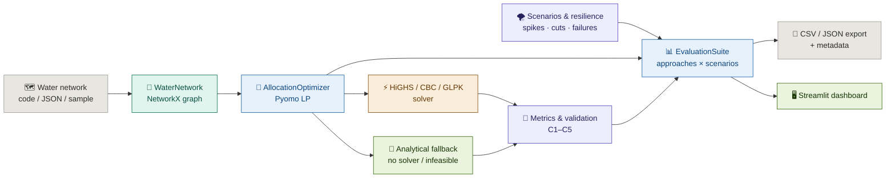

<div align="center">

[](https://github.com/ria0304/AquaRoute)
[](https://github.com/ria0304/AquaRoute/actions/workflows/ci.yml)


# AquaRoute — Algorithmic Optimization for Reliable Community Water Distribution


**Build the network. Set the priorities. Solve the allocation. Compare the strategies.**

AquaRoute turns a water distribution network — reservoirs, communities, and the pipelines between them — into a **single-commodity network-flow program**. It decides how much water each route should carry, enforces minimum-service guarantees for priority communities, and compares fairness-aware allocation strategies against four established baselines under demand spikes, supply cuts, and pipeline failures.

**Research domain:** Algorithms & Theory · Operations Research · Optimization · Water-Resource Management · Resilient Infrastructure

</div>

---

## The Problem

Allocating a limited water supply across many communities is a balancing act with no single right answer.

**Planners** must deliver as much water as possible, but also avoid repeatedly leaving the same communities with severe shortages, adapt when a pipeline fails or supply drops, and still protect communities designated as high priority.

**Existing network-flow and optimization methods** give a foundation, but real-world planning involves several competing requirements at once:

- **Efficiency** — deliver as much of the available water as possible
- **Fairness** — avoid concentrating shortages on a few communities
- **Reliability** — adapt when a pipeline becomes unavailable or supply falls unexpectedly
- **Priority protection** — respect minimum service levels for designated communities
- **Practicality** — find good allocations within a reasonable computation time

---

## The Solution

AquaRoute balances those requirements inside **one optimization framework**.

A user supplies a network in one of three ways:

- **Code** — build it with `add_reservoir`, `add_community`, `add_pipeline`
- **JSON** — load a network file such as `data/sample_network.json`
- **Dashboard** — start from the built-in sample and tune scenarios interactively

The system outputs:

- A **per-community allocation** and the **flow carried by every pipeline**
- **Five strategy variants** solved on the same network, so they can be compared like for like
- **Validated metrics** — shortage, fairness, delivery cost, runtime, and constraint checks C1–C5
- A **resilience profile** across demand spikes, supply cuts, and pipeline failures
- **Reproducible experiment exports** — CSV, JSON, and a metadata file recording seed, solver, and runtime
- An **interactive Streamlit dashboard** for scenario exploration

### The model

The network is a directed graph:

- **Nodes** are reservoirs (supply) or communities (demand)
- **Edges** are pipelines with a **capacity** and a per-unit **delivery cost**
- Water may be **transshipped** through communities, so a community can be served by routing water through its neighbours

Decision variables and constraints:

- `f[e] >= 0` — flow on each pipeline, `f[e] <= capacity[e]`
- `x[c]` — net water delivered to community `c`, `0 <= x[c] <= demand[c]`
- Reservoir balance: `sum(out) - sum(in) <= supply[r]`
- Community balance: `sum(in) - sum(out) = x[c]`
- Junction balance: `sum(in) - sum(out) = 0`

Every strategy first **maximises service** (minimises shortage) subject to any minimum-service guarantee, then breaks ties with a strategy-specific objective. The proportional-fairness metric is **linearised**, so the entire model stays a linear program, solved with **HiGHS** (CBC and GLPK are also tried) — with a **solver-free analytical fallback** when no solver is available or the LP is infeasible.

---

## Core User Flow

```
Water network (code / JSON / sample)
        ↓
WaterNetwork — NetworkX DiGraph: reservoirs, communities, pipelines
        ↓
AllocationOptimizer — builds the Pyomo LP
        ↓
Two-stage lexicographic solve
  · Stage 1 — minimise total shortage (maximise service)
  · Stage 2 — optimise the strategy-specific objective
        ↓
HiGHS / CBC / GLPK   ──or──   analytical fallback (no solver / infeasible)
        ↓
Metrics + constraint validation (shortage, fairness, cost, C1–C5)
        ↓
EvaluationSuite — approaches × scenarios × repeats
        ↓
CSV + JSON + metadata export  →  Streamlit dashboard
```

---

## Features

| Feature | Status |
|---|---|
| Single-commodity network-flow model (reservoir / community / junction balance) | ✅ |
| Transshipment — water routed through intermediate communities | ✅ |
| Five allocation strategies (`shortage_min`, `proportional`, `maxmin`, `uniform`, `weighted`) | ✅ |
| Lexicographic two-stage solve: service first, then strategy objective | ✅ |
| Linearised proportional-fairness objective (stays an LP) | ✅ |
| Minimum-service guarantees for priority communities | ✅ |
| Solver-free analytical fallback when no solver is installed | ✅ |
| Constraint validation (C1–C5) with hard / soft violation handling | ✅ |
| Scenario generation: demand spikes, supply cuts, pipeline failures, combined disruptions | ✅ |
| Resilience analysis, recovery planning, and seeded stress-test suites | ✅ |
| Comparative evaluation against four baselines | ✅ |
| Fairness and risk metrics: mean pairwise disparity, Jain's index, CVaR | ✅ |
| Statistics: t-test + Cohen's d, Wilcoxon, Cliff's delta, bootstrap CI, power analysis | ✅ |
| Sensitivity analysis over `alpha` / `beta` / `gamma` | ✅ |
| Reproducible experiments (seeded) → CSV / JSON / metadata export | ✅ |
| Interactive Streamlit + Plotly dashboard | ✅ |
| Editable install, console script for experiments, GitHub Actions CI (3.10–3.12) | ✅ |
| EPANET `.inp` import (`load_epanet_inp`, needs `wntr`) | 🧪 experimental |
| Post-hoc hydraulic check (`check_hydraulic_feasibility`, needs `wntr`) | 🧪 experimental |
| Scenario-sampled risk analysis (`solve_stochastic`) and multi-period storage (`solve_dynamic`) | 🧪 experimental |

🧪 marks code that exists but is untested and has known gaps — see [Experimental Modules](#experimental-modules) before relying on its output.

---

## Allocation Strategies

Every strategy is a distinct objective on the same network, so differences in results come from the method, not from relabelling one model.

| Strategy | Objective (after maximising service) | Role in the comparison |
|---|---|---|
| `shortage_min` | none — pure maximum delivery | Baseline A |
| `proportional` | minimise proportional disparity | Baseline B |
| `maxmin` | maximise the minimum service ratio (egalitarian) | Baseline C |
| `uniform` | minimise volumetric disparity | Baseline D |
| `weighted` | `alpha * shortage + beta * fairness + gamma * cost` | **AquaRoute** |

AquaRoute additionally supports **minimum-service guarantees** for priority communities via `min_service_priority` and `min_allocation`. In the default comparison it applies a 10-unit minimum to the highest-priority communities.

### How the two-stage solve works

1. **Stage 1** minimises total shortage — every strategy starts from the same maximum-service solution.
2. **Stage 2** applies the strategy-specific objective, with shortage pinned near its optimum (absolute tolerance `1e-7`), so no strategy trades away service to look better on its own metric.

Strategies therefore differ only in how they distribute unavoidable shortages.

### Minimum service as a hard constraint with a safety net

A minimum-service guarantee is a **hard** constraint. When it is physically impossible to satisfy, the LP is infeasible and the **analytical fallback** serves priority communities as far as supply allows, reporting a `C5` warning. In `get_results`, `C1`–`C4` are hard (they trigger the fallback) while `C5` is a soft warning.

---

## Fairness, Metrics & Resilience

**Fairness** is the *mean pairwise proportional disparity*: the mean, over all community pairs, of `|alloc_i/demand_i - alloc_j/demand_j|`. Zero means every community receives the same fraction of its demand; larger values mean greater inequity. Demand normalisation makes communities with different needs comparable. It is linearised with auxiliary variables to keep the model an LP.

Metrics reported per solution:

| Metric | What it tells you |
|---|---|
| `total_allocated` / `shortage` | How much requested water was delivered / left unmet |
| `fairness` | Whether shortages are distributed unevenly (lower is fairer) |
| `delivery_cost` | True routed cost `sum_e flow_e * cost_e` (or a cheapest-incoming lower bound) |
| `runtime` | How quickly the method found a solution |
| `validation_passed` | Whether all hard operational constraints are respected |
| `objective_value` | `alpha * shortage + beta * fairness + gamma * cost` |

`EvaluationSuite.compute_summary_metrics()` aggregates these per approach — average, standard deviation, and worst case for shortage, fairness, and cost — plus **Jain's fairness index**, **CVaR** (tail risk across scenarios), and the **feasibility rate**.

### Uncertainty & failure handling

`ScenarioGenerator` builds perturbed copies of a network without mutating the original:

| Scenario | Perturbation |
|---|---|
| `normal_scenario` | unchanged |
| `demand_spike_scenario` | demands × `spike_factor` (default 1.5) |
| `supply_reduction_scenario` | reservoir supply × `reduction_factor` (default 0.5) |
| `pipeline_failure_scenario` | one or more pipelines removed |
| `multiple_disruptions_scenario` | combined disruptions |

`FailureAnalyzer.analyze_resilience` runs an optimizer across a scenario list; `compute_resilience_metrics` summarises recovery; `optimize_recovery` reallocates through surviving infrastructure; `create_stress_test_suite(network, seed=...)` builds a reproducible set of random pipeline failures. Scenario generation, the stress-test suite, and the experiment runner are seeded; `solve_stochastic` (see below) draws from NumPy's global random state and is not.

---

## Research Methodology

The project follows five stages:

1. **Problem formulation** — define the water network, supply limits, demand, and minimum-service requirements.
2. **Mathematical modelling** — express allocation using graph-based flow variables, constraints, and an objective function.
3. **Algorithm design** — balance efficiency, fairness, and resilience in one framework.
4. **Experimental evaluation** — test under normal supply, demand spikes, supply reductions, and pipeline outages.
5. **Baseline comparison** — compare against standard network-flow and optimization methods.

The weighted objective minimises a combination of total shortage `S(x)`, unfairness `F(x)`, and delivery cost `C(x)`:

```
min_x   alpha * S(x) + beta * F(x) + gamma * C(x)
```

subject to source availability, pipeline capacities, and required minimum service levels. `alpha`, `beta`, and `gamma` set the relative importance of each term and are exposed as optimizer parameters.

---

## Evaluation Suite

`EvaluationSuite` runs **approaches × scenarios × repeats** and collects the same metrics for each.

**Default approaches:** the four baselines (A–D) and `aquaroute_weighted_min_service`.
**Default scenarios:** normal, demand spike ×1.5, supply reduction ×0.5, and a two-pipeline failure `(0→2, 1→5)`.

| Capability | Method |
|---|---|
| Run the comparison | `run_comparison(n_repeats, seed)` |
| Per-approach summary | `compute_summary_metrics()` |
| Significance testing | `statistical_significance(metric, approach_a, approach_b)` — t-test with Cohen's d and a confidence interval |
| Non-parametric checks | `wilcoxon_paired_test`, `cliffs_delta` |
| Uncertainty on estimates | `bootstrap_ci` |
| Required sample size | `power_analysis(metric, effect_size, alpha, power)` |
| Weight sensitivity | `sensitivity_analysis(metric, approach, param, values)` |
| Export | `export_results_csv`, `export_results_json` |
| Plot | `plot_results(...)` (needs `matplotlib`, not a declared dependency) |

---

## Dashboard

An interactive Streamlit app (`aquaroute/scripts/streamlit_dashboard.py`) for exploring a single scenario at a time.

- **Scenario selector** — Normal, Demand Spike, Supply Reduction, Pipeline Failure, Multiple Disruptions
- **Parameter sliders** — `alpha`, `beta`, `gamma`, minimum-service allocation, spike factor, reduction factor, and number of failed pipelines
- **Headline metrics** — total demand, total supply, shortage, and fairness
- **Allocation results** — per-community allocation, plus runtime, objective value, and solver status
- **Multi-scenario comparison** — one click evaluates two weighting configurations (`min_service_first` vs `fairness_weighted`) across scenarios and reports a significance test

The dashboard is a demonstration layer. The five-strategy, four-baseline comparison lives in `EvaluationSuite` and `run_experiments`.

---

## Experimental Modules

These five pieces are in the codebase but have **no tests** and the gaps below. Treat anything they produce as exploratory, not as a research result. The core optimizer, strategies, scenarios, and evaluation suite above are the tested part of the project.

| Module | What it does today | Known gaps |
|---|---|---|
| `load_epanet_inp` (`aquaroute/data/loaders.py`) | Converts an EPANET `.inp` into a `WaterNetwork` and records what it preserved in a metadata dict | Reservoir supply is set to `base head ÷ 10` — a scaling assumption, not a physical conversion. Every pipe gets **infinite capacity** and cost `1.0`; diameter, length, and roughness are kept in metadata only. Every community gets priority `1`. Pipes are added only in their EPANET start→end direction. Pumps are not read, and tanks become plain junctions. `to_wntr` is a best-effort stub, not a faithful round-trip. |
| `get_benchmark_networks` (`evaluation.py`) | Builds Net1–Net3 from WNTR's bundled `.inp` files; falls back to three small sample networks | It does **not** use `load_epanet_inp`. It adds reservoirs and communities but **no pipelines** (the pipe loop is a no-op), assigns default priority, and searches a hard-coded site-packages path before scanning the working directory. The fallback sample networks add only one pipe each. |
| `check_hydraulic_feasibility` (`optimizer.py`) | Runs EPANET through WNTR and flags nodes outside a 20–100 m pressure band | It rebuilds a synthetic model — every pipe 1000 m long, 0.3 m diameter, roughness 100, reservoir head = supply × 10 — and simulates node **demands**. The `allocations` argument is not used, so results do not depend on the allocation strategy. It reports pressure heads and flows but not velocities. |
| `AllocationOptimizer.solve_stochastic` | Draws demand and supply multipliers in 0.7–1.3, solves each scenario independently, averages the allocations, and reports the CVaR of the scenario shortages | CVaR is **measured after the fact, not optimised** (no Rockafellar–Uryasev formulation). Randomness is not seeded by the method. |
| `AllocationOptimizer.solve_dynamic` | Loops over periods and tracks a clamped storage level `S(t+1) = S(t) + supply − allocated` | Storage is bookkeeping, not an LP constraint, and the per-period demands are not applied to the network that is solved. Its shortage and storage numbers are not evidence about the method. |

Any Net1/Net3 result, including the draft comparison plot in `figures/`, depends on EPANET loading and should be regenerated once these gaps are fixed.

---

## Architecture



---

## Tech Stack

| Component | Technology | Purpose |
|---|---|---|
| Language | Python 3.10+ | Main research software |
| Graph modelling | [NetworkX](https://networkx.org/) | Reservoirs, communities and pipelines as a directed graph |
| Optimization | [Pyomo](https://www.pyomo.org/) | Express allocation objectives and constraints |
| Solver | HiGHS (via `highspy`), CBC, or GLPK | Solve the linear program |
| Data processing | NumPy, pandas, SciPy | Demands, capacities, simulation data, statistical tests |
| Dashboard | Streamlit, Plotly | Interactive demonstration |
| Testing | pytest, pytest-cov | Algorithm behaviour and constraints |
| Linting | Ruff (configured in `pyproject.toml`) | Correctness and import hygiene |
| CI | GitHub Actions | pytest on Python 3.10 / 3.11 / 3.12 plus an experiment smoke test |
| Optional | `wntr` | EPANET `.inp` import and hydraulic feasibility check |

---

## Project Structure

```
AquaRoute/
│
├── aquaroute/
│   ├── __init__.py
│   ├── models/
│   │   └── water_network.py        # NetworkX graph model, JSON / dict loading, sample network
│   ├── algorithms/
│   │   ├── optimizer.py            # Network-flow LP, 5 strategies, metrics, validation, fallback
│   │   ├── uncertainty.py          # Scenario generation, resilience analysis, recovery planning
│   │   └── evaluation.py           # Comparative evaluation, statistics, sensitivity, export
│   ├── data/
│   │   └── loaders.py              # EPANET .inp → WaterNetwork loader (experimental, needs wntr)
│   ├── scripts/
│   │   ├── run_experiments.py      # Reproducible experiment runner (CLI)
│   │   └── streamlit_dashboard.py  # Interactive demo
│   └── tests/
│       ├── test_optimizer.py       # supply / pipeline binding, transshipment, min service
│       ├── test_uncertainty.py     # scenarios, resilience, seeded reproducibility
│       ├── test_water_network.py   # graph construction + JSON loading
│       └── test_evaluation.py      # baseline distinctness, export, summary metrics
│
├── data/
│   └── sample_network.json         # Synthetic benchmark: 2 reservoirs, 5 communities, 9 pipelines
│
├── figures/
│   ├── optimization_comparison.png # Draft Net1 vs Net3 plot (to be regenerated)
│   └── optimization_comparison.pdf
│
├── .github/workflows/ci.yml        # CI: pytest matrix (3.10–3.12) + experiment smoke test
├── requirements.txt                # Pinned runtime dependencies (incl. HiGHS)
├── requirements-dev.txt            # Dashboard + test tooling
├── pyproject.toml                  # Packaging, extras, console scripts, pytest + ruff config
├── research_project.odt            # Research proposal and project background
├── LICENSE                         # MIT
└── readme.md
```

---

## Run Locally

**Step 1 — Clone and install**

```bash
git clone https://github.com/ria0304/AquaRoute.git
cd AquaRoute

# Editable install with the HiGHS solver (recommended)
pip install -e ".[solver]"

# …or a pinned, known-good set
pip install -r requirements.txt
```

Optional extras:

```bash
pip install -e ".[dashboard]"   # Streamlit + Plotly
pip install -e ".[dev]"         # pytest + coverage
```

Without a solver backend installed, AquaRoute still runs — it automatically uses the built-in analytical fallback.

**Step 2 — Run an experiment**

```bash
python -m aquaroute.scripts.run_experiments --repeats 5 --seed 42 --outdir results
# or, after installing: aquaroute-experiments --repeats 5 --seed 42 --outdir results
```

**Step 3 — Launch the dashboard**

```bash
streamlit run aquaroute/scripts/streamlit_dashboard.py
```

---

## Verify it works

```bash
pytest
```

Then a one-minute check on the bundled network:

```python
from aquaroute.models.water_network import WaterNetwork
from aquaroute.algorithms.optimizer import AllocationOptimizer

network = WaterNetwork.from_json("data/sample_network.json")
print(network)                              # WaterNetwork: 2 reservoirs, 5 communities, 9 pipelines

opt = AllocationOptimizer(network, strategy="shortage_min")
opt.solve()
r = opt.get_results()
print(r["solver"], r["shortage"], r["validation_passed"])
```

`solver` reports the backend that actually ran, so you can see at a glance whether HiGHS or the analytical fallback produced the answer. Tests that need an LP solver are skipped automatically when none is installed.

---

## Reproducible Experiments

| Flag | Description |
|---|---|
| `--network` | Path to a JSON network file (defaults to the sample network) |
| `--repeats` | Repeats per scenario, averaged (default 5) |
| `--seed` | Random seed for reproducible scenario ordering (default 42) |
| `--outdir` | Output directory, created if needed (default `results`) |
| `--label` | Optional label appended to output filenames |

The runner evaluates every approach on every scenario, prints a summary table (shortage, fairness, cost, feasibility %), and writes three files:

- `results_<timestamp>.csv` — per-approach summary metrics
- `results_<timestamp>.json` — full results
- `meta_<timestamp>.json` — seed, repeats, runtime, solver, summary, scenario types

All randomness is seeded, so runs with the same `--seed` reproduce exactly.

### Network file format

```json
{
  "reservoirs":  [{"node_id": 0, "capacity": 100.0, "supply": 100.0}],
  "communities": [{"node_id": 2, "demand": 20.0, "priority": 1}],
  "pipelines":   [{"from_node": 0, "to_node": 2, "capacity": 30.0, "delivery_cost": 1.0}]
}
```

`data/sample_network.json` is a complete example: 2 reservoirs, 5 communities, and 9 pipelines, including community-to-community links for transshipment.

---

## Programmatic Use

```python
from aquaroute.models.water_network import WaterNetwork
from aquaroute.algorithms.optimizer import AllocationOptimizer
from aquaroute.algorithms.evaluation import EvaluationSuite

network = WaterNetwork.from_json("data/sample_network.json")

optimizer = AllocationOptimizer(
    network,
    strategy="weighted",          # shortage_min | proportional | maxmin | uniform | weighted
    alpha=1.0, beta=1.0, gamma=1.0,
    min_service_priority=[2, 4],  # priority community IDs
    min_allocation=10.0,
)
optimizer.solve()
results = optimizer.get_results()

print(results["shortage"], results["fairness"], results["delivery_cost"])
print(results["validation_passed"], results["validation_warnings"])

# Comparative evaluation across approaches and scenarios
suite = EvaluationSuite(network=network, seed=42)
comparison = suite.run_comparison(n_repeats=5, seed=42)
summary = suite.compute_summary_metrics()
```

---

## Configuration Reference

**`AllocationOptimizer(network, ...)`**

| Parameter | Default | Description |
|---|---|---|
| `strategy` | `"weighted"` | One of `weighted`, `shortage_min`, `uniform`, `maxmin`, `proportional` |
| `alpha` | `1.0` | Weight on total shortage (used by `weighted`) |
| `beta` | `1.0` | Weight on unfairness (used by `weighted`) |
| `gamma` | `1.0` | Weight on delivery cost (used by `weighted`) |
| `min_service_priority` | `None` | Community IDs that must receive a guaranteed minimum |
| `min_allocation` | `0.0` | The guaranteed minimum for those communities |
| `solver_name` | `None` | Force a solver; otherwise tries `appsi_highs`, `highs`, `cbc`, `glpk` |

**`.solve(solver_name=None, time_limit=None, allow_fallback=True)`** — set `allow_fallback=False` to get `None` instead of a heuristic answer when no solver is available or the LP is infeasible.

**Packaging extras (`pyproject.toml`)**

| Extra | Installs | Needed for |
|---|---|---|
| `solver` | `highspy` | Exact LP solves (otherwise the analytical fallback is used) |
| `dashboard` | `streamlit`, `plotly` | The interactive dashboard |
| `dev` | `pytest`, `pytest-cov` | Running the test suite |

---

## API Reference

**Model — `aquaroute.models.water_network`**

| Item | Description |
|---|---|
| `WaterNetwork()` | Directed graph of reservoirs, communities, and pipelines |
| `.add_reservoir(node_id, capacity, supply)` | Add a supply node |
| `.add_community(node_id, demand, priority)` | Add a demand node |
| `.add_pipeline(from_node, to_node, capacity, delivery_cost)` | Add a capacitated, costed edge |
| `.get_reservoirs()` / `.get_communities()` | Node ID lists |
| `.total_demand()` / `.total_supply()` | Network totals |
| `WaterNetwork.from_json(path)` / `.from_dict(data)` | Load a network |
| `create_sample_network()` | The built-in 2-reservoir, 5-community benchmark |

**Optimizer — `aquaroute.algorithms.optimizer`**

| Item | Description |
|---|---|
| `AllocationOptimizer` | Builds and solves the network-flow LP |
| `.build_model()` | Build the Pyomo model |
| `.solve(...)` | Two-stage lexicographic solve with analytical fallback |
| `.get_results()` | Allocations, flows, metrics, validation, runtime |
| `compute_shortage`, `compute_fairness`, `compute_delivery_cost` | Standalone metric functions |
| `validate_solution` | Constraint checks C1–C5 |
| `effective_capacities`, `max_total_deliverable` | Upper bounds on what the network can deliver |
| `compute_cvar(losses, alpha)` | CVaR of a list of losses (a reported metric, not an optimisation objective) |
| 🧪 `.solve_stochastic(...)`, `.solve_dynamic(...)` | Experimental — see [Experimental Modules](#experimental-modules) |
| 🧪 `check_hydraulic_feasibility(network, allocations, demands)` | Experimental WNTR check — see [Experimental Modules](#experimental-modules) |

**Uncertainty — `aquaroute.algorithms.uncertainty`**

| Item | Description |
|---|---|
| `ScenarioGenerator` | Normal, demand-spike, supply-reduction, pipeline-failure, and combined scenarios |
| `apply_scenario(network, scenario)` | Mutate a network in place to match a scenario |
| `FailureAnalyzer.analyze_resilience` | Run an optimizer across scenarios |
| `FailureAnalyzer.compute_resilience_metrics` | Summarise recovery across results |
| `FailureAnalyzer.optimize_recovery` | Reallocate through surviving infrastructure |
| `create_stress_test_suite(network, seed=...)` | Reproducible random-failure suite |

**Evaluation — `aquaroute.algorithms.evaluation`**

| Item | Description |
|---|---|
| `EvaluationSuite` | Approaches × scenarios × repeats, with statistics and export |
| `compare_approaches(network, ...)` | One-call convenience wrapper (20 repeats) |
| `jains_fairness_index`, `compute_cvar_from_scenarios` | Extra fairness and tail-risk metrics |
| 🧪 `get_benchmark_networks()` | Experimental — builds Net1–Net3 from WNTR's bundled files, or three tiny sample networks otherwise. See [Experimental Modules](#experimental-modules) |
| 🧪 `aquaroute.data.loaders.load_epanet_inp(path)` | Experimental EPANET import returning `(network, metadata)` |

---

## Tests

```bash
pytest
```

The suite (47 test functions) verifies:

- **Optimiser correctness** — supply / pipeline binding, transshipment routing, minimum service
- **Metric boundary conditions** — fairness and shortage at the extremes
- **Baseline distinctness** — strategies do not collapse to the same allocation
- **Weight sensitivity** — `alpha` / `beta` / `gamma` change the solution as expected
- **Reproducibility** — identical seeds give identical results
- **Result export** — CSV / JSON round-trips

None of the [experimental modules](#experimental-modules) is covered by these tests. CI runs `pytest` on Python 3.10, 3.11, and 3.12, then a one-repeat experiment as a smoke test. To lint locally, install Ruff yourself (`pip install ruff`) and run `ruff check aquaroute`.

---

## Common Issues

| Problem | Fix |
|---|---|
| No solver detected | Install HiGHS with `pip install -e ".[solver]"` — or rely on the analytical fallback |
| `ModuleNotFoundError` on startup | Re-run `pip install -r requirements.txt` |
| Solver-dependent tests are skipped | Expected without a solver; install the `solver` extra to run them |
| Infeasible LP | A minimum-service guarantee may be impossible; check `validation_warnings` for `C5` |
| Dashboard won't launch | `pip install -e ".[dashboard]"`, then use `streamlit run aquaroute/scripts/streamlit_dashboard.py` |
| `ModuleNotFoundError: wntr` | Only the EPANET loader and hydraulic check need it; `pip install wntr` |
| `plot_results` fails | It imports `matplotlib`; `pip install matplotlib` |
| Results not reproducible | Pass the same `--seed` to `run_experiments` |
| Mermaid diagram looks cut off on GitHub | Use the zoom / pan controls, or open the README full-screen |

---

## Deployment

Local-only. The project runs from the command line and a local Streamlit server — see **Run Locally** above. There is no Dockerfile in this repository, and the `results/` output folder is gitignored.

---

## Known Limitations

- **Volumetric flow, not hydraulics.** The LP models flow, capacity, and cost. Pressure, head loss, water quality, and pipe sizing are not part of the optimisation. `check_hydraulic_feasibility` is experimental and currently simulates a synthetic pipe network driven by demands, not the allocation itself.
- **Synthetic data by default.** No real utility dataset ships with the project; the sample network is a benchmark. The EPANET paths are experimental: the loader assigns infinite pipe capacity, unit cost, and uniform priority and derives reservoir supply from head, and `get_benchmark_networks` adds no pipelines at all, so Net1–Net3 runs do not yet test capacity or priority behaviour. It also needs `wntr`, which is not a declared dependency.
- **Costs are estimates.** Delivery cost uses a per-unit edge cost, or a cheapest-incoming lower bound when only volumetric allocations are known.
- **The fallback is heuristic.** The analytical fallback (used without a solver or on infeasibility) prioritises service as far as supply allows but is not guaranteed optimal.
- **Fairness is one metric in the objective.** Proportional disparity drives the model; Jain's index and CVaR are reported but not optimised, and other equity notions (e.g. Gini) are not modelled.
- **Scenario-based uncertainty.** Disruptions are sampled or specified scenarios, re-solved one at a time. CVaR is computed from the resulting shortages; it is not optimised, so this is not a stochastic or robust optimisation model.
- **No multi-period model yet.** `solve_dynamic` tracks storage but does not enforce it in the LP, so the project does not currently model shortages carried across time.
- **Experimental code is untested.** See [Experimental Modules](#experimental-modules).
- **Dashboard comparison is narrower than the suite.** The dashboard compares two weighting configurations; the full baseline comparison runs through `EvaluationSuite` and `run_experiments`.
- **Local only.** No Dockerfile and no hosted deployment.

> **Research status.** This is a research prototype with reproducible evaluation. An initial literature search found that robust optimization for water-distribution uncertainty already exists (e.g. adjustable robust optimization for water-distribution operations, 2023–2024). The novelty of AquaRoute's specific combination of fairness, minimum-service guarantees, and resilience is still to be established through a dedicated literature and patent search.

---

## Future Scope

| Feature | Why |
|---|---|
| Pressure & hydraulic constraints in the model | Move from volumetric flow to hydraulically realistic routing |
| Richer equity metrics | Optimise against Gini and priority-weighted fairness, not just report them |
| Stochastic / robust optimization | Model supply and demand uncertainty directly rather than by scenario sampling |
| Declare optional dependencies | Add `wntr` and `matplotlib` as extras so the EPANET loader and plots install cleanly |
| History-aware fairness | Let past shortages shift who bears the next one, so the same communities are not repeatedly short — the stated motivation, not yet modelled |

---

## License

Released under the [MIT License](LICENSE).
